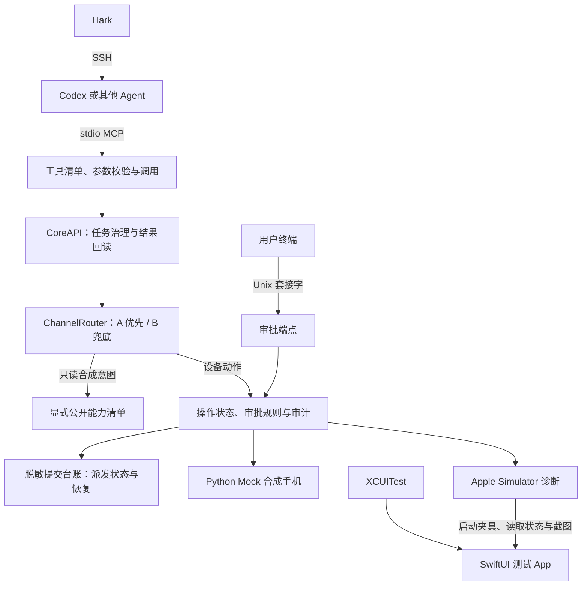

# PhoneBridge 架构

Agent 负责理解自然语言和规划操作。PhoneBridge 校验 MCP 请求，执行驱动允许的动作并返回状态，审批由用户在独立终端发出。Hark 经 SSH 接到运行 Agent 的主机，整个执行器可在该主机上工作；`serve` 是一次性 stdio 会话，`backend` 配合 `relay` 让多次 SSH／客户端连接共享同一份服务状态。核心在任务引擎里做通道 A 优先、通道 B 兜底的路由决策，B 的设备动作仍逐笔走审批。[Hark 接入](hark-codex.md) · [iOS 可行性](ios-feasibility.md)

## v0.4 模块

| 位置 | 职责 |
| --- | --- |
| `phonebridge/cli.py` | 选择 `mock`、`simctl` 或 `xcode-mcp`，以 `serve`（stdio）或 `backend`（私有 Unix 套接字 + relay）启动 MCP 服务和可选审批端点，或发出审批命令。 |
| `phonebridge/mcp_v04.py` | 管理 stdio JSON-RPC 握手、发现、工具入参与结果；作为薄壳调用稳定内部 API。 |
| `phonebridge/api.py` | `CoreAPI.dispatch` 统一 MCP 和未来 App 的内部入口，限制任务时间、动作次数和重试。回读不明会暂停写入，未决提交的暂停由台账在后端启动时恢复。恢复核对只走可信审批端。通道 A 根据驱动公布合成能力，B 的交互和审批仍走同一核心。 |
| `phonebridge/intents.py` | 通道 A 的显式公开能力清单与 `ChannelRouter`：只登记自有合成夹具的无副作用只读能力；未公开能力只返回「可走 B」的决策，不自动执行设备动作；写意图直接拒绝；A 失败需确认无副作用才可回退，回读不明则暂停写入且不自动重试。**不调用真实 App Intents 或快捷指令**。 |
| `phonebridge/core.py` | 校验设备上下文与输入，绑定审批到操作 ID、联系人、正文与状态版本；`approve` / `deny` 先持久化再改内存，`execute` 只委托唯一提交门。 |
| `phonebridge/submissions.py` | `SubmissionLedger` 持久化脱敏状态迁移与派发前记录基线（0700 目录 / 0600 文件、`flock`、`fsync`），是审批状态的**唯一事实来源**；`SubmissionGate` 是唯一允许调用 `driver.virtual_send` 的路径，派发前须确认台账中有 `approved` 事件，恢复只接受可归属到该收件人的新增记录，否则暂停且不自动重发。 |
| `phonebridge/approvals.py` | 本机 Unix 套接字处理提案查看、批准和拒绝；令牌为本地可用隔离。默认 0700 目录 / 0600 套接字下 `--approval-uid` 只披露为 `external_uid_unverified`；`hosted` 模式叠加具名 ACL 与逐连接对端 UID 校验，授权失败 fail closed，隔离升级为 `token+external_uid`。 |
| `phonebridge/hosted.py` | 外部托管审批端点的 OS 层授权：给一个具名审批 UID 配置并核验目录 `search`、套接字 `read,write` 的文件系统 ACL（macOS `chmod +a` / `ls -lde`），校验目录与套接字仍属服务账号且都不全局可写；其他平台显式返回不支持。 |
| `phonebridge/drivers.py` | `MockIPhone` 模拟合成私信场景、联系人、输入焦点与记录。`AppleSimulatorDriver` 调用 `xcrun simctl` 读取选定设备状态、启动自有夹具及保存截图。 |
| `phonebridge/xcode_mcp.py` | `XcodeMCPDriver` 通过 Apple 官方 `xcrun mcpbridge` 观察设备状态、激活夹具并按需合成交互；只用设备交互／诊断工具白名单，改变状态的操作需人工显式开启。每次交互前按新鲜层级定位启用的提交控件，通用点击／滑动命中即在派发交互命令前拒绝，无法定位即 fail closed；`record_count()` 从当次层级提供记录数。每次新鲜观察后从层级解析合成上下文（`app` / `screen` / `selected_id` / `input_text` / `contacts` / 仅当前联系人的 `messages`），使审批核心无需设备专用分支；`virtual_send` 只在操作者显式开启时由唯一提交门调用，绑定目标与正文并回读确认只新增一条合成记录，**不是真实发送**。 |
| `phonebridge/relay.py` | 可重连传输：后端进程持有 `CoreAPI`、审批与台账状态，监听 0700 目录内的 0600 Unix 套接字；每次 stdio 连接新建一个 MCP 协议会话，客户端断开或重连不影响服务状态。 |
| `phonebridge/hark.py` | 主机侧接入 helper：发现或指定 Codex 客户端、构造 inline MCP 配置与 SSH 包装、解析结构化事件，并从客户端环境中移除审批令牌。 |
| `simulator/`、`scripts/` | SwiftUI 测试 App（私信与信息流两个合成场景）、XCUITest、XcodeGen 工程描述、Apple 测试脚本与主机侧联调脚本。 |

## 模拟发送顺序

1. **观察。** 读取当前驱动和会话，打开合成私信场景（`messaging`），按精确名称或固定 ID 找联系人。名称重合时选择已确认的固定 ID。
2. **规划与拟稿。** 聚焦输入区，录入文本。`message_prepare` 校验聊天与正文，返回待审批的 `approval_id`。
3. **审批与执行。** 用户从当前会话的审批端点核对并批准。`phone_execute_operation` 校验授权、会话状态和有效期，持锁执行一次模拟写入。
4. **验证。** `phone_inspect` 回读当前联系人与记录。验证指定消息只增加一次，保留合成结果和必要的审计元数据。

每个服务进程拥有独立的内存状态。重启后联系人夹具恢复初始状态，聊天记录和提案清空。单个 Mock 会话内通过操作 ID 防重。跨进程持久化、任务预算与重试策略属于后续执行器工作。审批套接字当前适用于受控模拟，实际设备连接需要 Agent 权限之外的可信审批。[安全边界](security.md)

v0.3 继续通过 `run_phonebridge.py` 提供原有 8 项工具与审批接口。v0.2 源码可单独复跑。[合并记录](merge-existing-github.md) · [Apple 测试步骤](apple-simulator.md)
