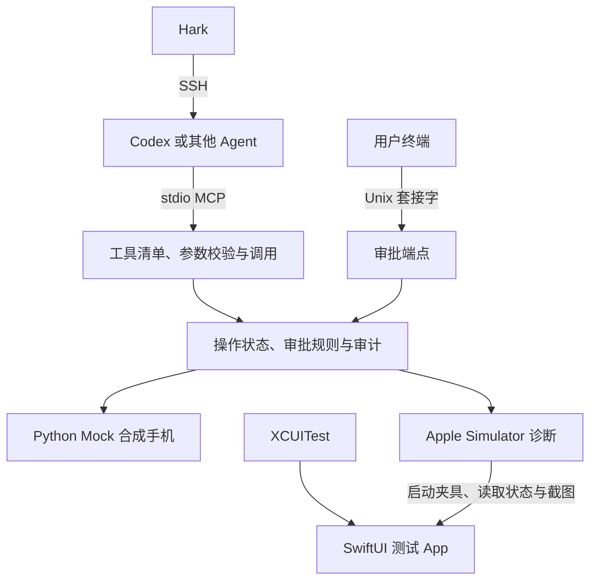

# PhoneBridge 架构

Agent 负责理解自然语言和规划操作。PhoneBridge 校验 MCP 请求，执行驱动允许的动作并返回状态，审批由用户在独立终端发出。Hark 经 SSH 接到运行 Agent 的主机，整个执行器可在该主机上工作。[Hark 接入](hark-codex.md)

## v0.4 模块

| 位置 | 职责 |
| --- | --- |
| `phonebridge/cli.py` | 选择 `mock` 或 `simctl`，启动 MCP 会话和可选审批端点，或发出审批命令。 |
| `phonebridge/mcp_v04.py` | 管理 stdio JSON-RPC 握手、发现、工具入参与结果。 |
| `phonebridge/core.py` | 校验设备上下文与输入，绑定审批到操作 ID、联系人、正文与状态版本，执行前再次检查有效期和状态。 |
| `phonebridge/approvals.py` | 本机 Unix 套接字处理提案查看、批准和拒绝。 |
| `phonebridge/drivers.py` | `MockIPhone` 模拟合成私信场景、联系人、输入焦点与记录。`AppleSimulatorDriver` 调用 `xcrun simctl` 读取选定设备状态、启动自有夹具及保存截图。 |
| `phonebridge/xcode_mcp.py` | `XcodeMCPDriver` 通过 Apple 官方 `xcrun mcpbridge` 观察设备状态、激活夹具并按需合成交互；只用设备交互／诊断工具白名单，改变状态的操作需人工显式开启。 |
| `simulator/`、`scripts/` | SwiftUI 测试 App（私信与信息流两个合成场景）、XCUITest、XcodeGen 工程描述与 Apple 测试脚本。 |

## 模拟发送顺序

1. **观察。** 读取当前驱动和会话，打开合成私信场景（`messaging`），按精确名称或固定 ID 找联系人。名称重合时选择已确认的固定 ID。
2. **规划与拟稿。** 聚焦输入区，录入文本。`message_prepare` 校验聊天与正文，返回待审批的 `approval_id`。
3. **审批与执行。** 用户从当前会话的审批端点核对并批准。`phone_execute_operation` 校验授权、会话状态和有效期，持锁执行一次模拟写入。
4. **验证。** `phone_inspect` 回读当前联系人与记录。验证指定消息只增加一次，保留合成结果和必要的审计元数据。

每个服务进程拥有独立的内存状态。重启后联系人夹具恢复初始状态，聊天记录和提案清空。单个 Mock 会话内通过操作 ID 防重。跨进程持久化、任务预算与重试策略属于后续执行器工作。审批套接字当前适用于受控模拟，实际设备连接需要 Agent 权限之外的可信审批。[安全边界](security.md)

v0.3 继续通过 `run_phonebridge.py` 提供原有 8 项工具与审批接口。v0.2 源码可单独复跑。[合并记录](merge-existing-github.md) · [Apple 测试步骤](apple-simulator.md)
